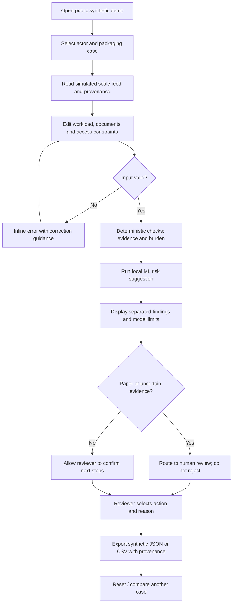
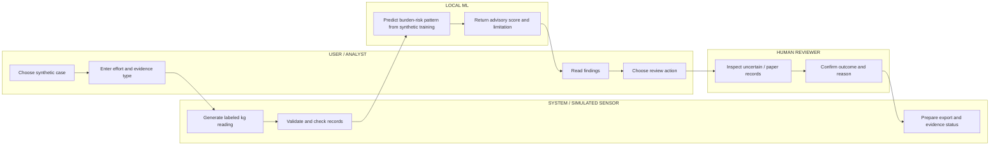

# WEEK 11 — BUSINESS BENDING BUILD PACKET
## Evidence Burden Check · Packaging Evidence Burden Check

**Builder:** Hana Dager Abascal · **Team:** 8 · **Role:** USER  
**Chapter:** 10, *Dreaming of Plenitude* · **Chosen vacuum:** EPR-COMPLIANCE  
**Blueprint assignment:** Condition 5 — Human consequences; all six conditions and Shadow Clause apply  
**Status:** PRE-CODE PLAN · v3.0 FINAL (CODE + RENDERED DIAGRAMS) · 21 October 2026  
**Evidence standard:** All demo people, companies, packaging records, sensor readings, and model labels are synthetic. This is a research prototype, **not** a compliance certificate or proof of recycling.

> **Product thesis:** A packaging-evidence workflow that makes a producer's reporting easier may simultaneously increase unpaid paperwork for a supplier or exclude a collector who only has paper records. Before calling that workflow successful, we need to see **who benefits, who does the work, and who risks being left out**.

## 1. Problem in my words — the USER lens

The Team 8 Blueprint selects **EPR-COMPLIANCE**, specifically a *Packaging Evidence Diagnostic* that reconciles packaging records for producers and importers. Our individual slice is not another all-purpose EPR dashboard. It is an **Evidence Burden Check**: a working test of whether evidence requirements move the cost of compliance onto people with less bargaining power. A producer could get cleaner records while a small supplier spends more hours filling forms, or a collector with a legitimate paper receipt is blocked for lacking a digital file.

The decision we help a human reviewer make is: **Can this case proceed for review, what burdens and exclusion risks are present, and what support or evidence is needed?** We do **not** answer whether a material was truly recycled, whether a company is legally compliant, or whether a worker has been paid. Those claims need separate proof.

### Exact users, payers and affected humans

| Person | Specific job / need | Benefit they hope for | Risk we must not hide |
|---|---|---|---|
| **Primary hands-on user:** packaging compliance analyst at a Mexican producer/importer | Assess a packaging evidence case before requesting more records | Understand missing evidence and downstream burdens | Mistaking a convenient score for proof of compliance |
| **Affected user:** small packaging supplier or recovery-network coordinator | Submit records without unnecessary repeated admin work | Clear requirements; workable paper/digital paths | Extra unpaid hours, inconsistent requests |
| **Affected user:** informal collector (represented through synthetic case only) | Have legitimate paper-based evidence considered by a human | Not be automatically discarded because of format | Exclusion, profiling, retaliation, nonpayment |
| **Potential payer:** producer/importer compliance team | Reduce reconciliation friction | Better decisions and traceable exception routing | Commercial value and recurring willingness to pay **unproven** |
| **Accountable reviewer:** trained human | Decide next steps using evidence and context | Explainable burden/exclusion findings | Overreliance on ML suggestion |

**Persona we will later test:** *María*, fictional, age 52, coordinates recyclable collection and uses paper receipts and occasional WhatsApp. She is not a real participant or an interview. The persona test must probe if she can understand an outcome without needing to upload sensitive information.

## 2. Success definition — what must work before the module closes

**Before the module closes, a visitor at a live HTTPS URL can choose one of three synthetic packaging-evidence cases, inspect a clearly labeled simulated scale feed, edit bounded workload and documentation inputs, run a genuine local ML inference, see explainable burden and exclusion findings, preserve paper records as `NEEDS HUMAN REVIEW` instead of `REJECTED`, and export a traceable, synthetic assessment as JSON or CSV.**

The visitor can repeat an assessment with changed inputs and see the output change. The tool separates **record completeness**, **burden exposure**, and **verified recovery** (always *not established* by this tool). Its results must be understandable without prior knowledge of EPR terminology.

**Measurable acceptance targets (prototype targets, not evidence of social impact):**

- Three working case presets: paper-only collector, mixed-format supplier, digitally documented producer.
- Simulated weight feed displays timestamp, unit (kg), source = `SIMULATED`, and uncertainty; never calls an observation proof of recycling.
- ML model trained locally on labeled **synthetic** examples, with accessible model details and at least one deterministic holdout test; actual model inference runs in the product (not a hardcoded “AI score”).
- At least three meaningful recommendations tied to user inputs, with evidence status and a required human-review step.
- Paper-only case is **never automatically rejected**; a reviewer can accept, request support, or mark unresolved with a recorded reason.
- No secrets, no real personal data, validated inputs, passing automated tests, live Vercel deploy, documented bug fix and redeploy.

**Not success:** impressive charts, a high ML confidence number, a generic recycling tip, counting message clicks, or claiming a demonstrable worker benefit from fictitious data.

## 3. Image-generated product mockup


*Figure 1. Image-generated visual concept (21 October 2026). The implementation may simplify this layout. The image is not proof that features already work; every number and result displayed is illustrative.*

**UI contract derived from the mockup:** a clear “demo/simulated” banner; participant selector; documentation hours and record formats; device-access questions; a simulated sensing panel; ML advisory findings and plain-English reasons; actionable human-review routing; an export button. Mobile layout must retain labels, accessible contrast, and no required login because no personal data is stored.

## 4. Feature flow — Mermaid diagrams

### 4A. Feature flowchart

**Diagram as code (Mermaid):**



**Rendered visual — feature flow:**


### 4B. Swimlane — ownership of decisions

**Diagram as code (Mermaid):**



**Rendered visual — actor swimlane:**


**Responsibility rule:** sensing reports an observation, deterministic checks identify missing information, ML offers a *suggestion*, and only a human records a review decision. The app never auto-confirms recovered mass, payment, EPR eligibility, or legal compliance.

## 5. Dragon Stack — actual plan, not decorative labels

| Required layer | Free implementation | Real behavior and proof | Limitation |
|---|---|---|---|
| **IoT / sensing** | Timestamped simulated material-scale feed in TypeScript, optionally seeded for reproducibility | `reading_id`, `kg`, `timestamp`, `source: SIMULATED`, `device_id: DEMO_SCALE_01`, stable/replayed sample | No hardware or physical validation. Does not confirm material type, receipt authenticity, recycling or pay |
| **ML** | Small logistic regression classifier trained offline in Python/scikit-learn on synthetic scenarios; export coefficients/normalization to JSON, perform inference in TypeScript | Predict **burden escalation risk** using hours, paper-only, digital access, missing fields and evidence conflicts. Show version, features, test split and holdout metrics | Training on invented examples means **no externally validated predictive accuracy**. Score is research-only, nonbinding |
| **Third layer: marketplace / allocation logic** | Transparent matching of identified support need to 3 fictitious reviewer/support options (paper digitization help, supplier follow-up, human exception review) | Fixed rules plus reviewer override, matched action, estimated review minutes, unresolved queue; support capacity explicitly simulated | No actual marketplace, worker onboarding, payment or operational commitment |
| **Web product** | Next.js + TypeScript + Tailwind CSS; no database in MVP | Form, cases, logic, export, responsive layout | No real records or multi-tenant workflow |
| **Tests/deploy** | Vitest (unit), Playwright (smoke), GitHub, Vercel free plan | Test logs, Git commits, two production deployments | External browser/runtime availability may constrain automation |

**ML integrity details:** Synthetic dataset ≥120 scenarios; fix random seed; train/test split fixed; serialize coefficient weights and intercept plus feature schema. Compare model score with transparent deterministic flags. **Do not train on protected characteristics, real worker identities, age, gender, ethnicity, location or names.** If model score and rules disagree, display `REVIEW REQUIRED` and both explanations. Do not equate a model score to verified probability of real harm.

## 6. Records, logic, and real user-facing outputs

**Case schema (synthetic only):** `caseId`, `actorType`, `packagingMaterial`, `weightReading`, `evidenceFormat` (`digital|paper|mixed|none`), `recordStatus` (`provided|missing|conflicting`), `hoursPerWeek` (0–40), `digitalAccess` (`yes|limited|no`), `extraCostMxnPerMonth` (0–10000), `source`, `scenarioLabel`, `reviewStatus`, `reviewReason`, `modelVersion`.

**Calculation boundaries:** `monthlyHours = hoursPerWeek × 52 / 12` (estimate). Do not turn hours into monetary loss unless a user supplies an explicitly **hypothetical** hourly value. Missing supplier fields produce a gap, not a claim of fraud. Conflicting kg weights produce a discrepancy warning, not a recycling judgment. Paper receipts receive a **human-check route**, never an automatic ban. Never label workers high risk as people; labels refer to workflow burdens only.

| Demo scenario | Input | Expected finding | Proposed action |
|---|---|---|---|
| **PAPER-01** collector, paper receipt, 7h/week, no digital access | Simulated 135 kg; paper receipt | Documentation-access friction; observation unverified | Offer assisted paper review, do not exclude |
| **MIXED-02** supplier, mixed records, 4h/week, conflicting supplier weight | Simulated 90 kg vs entered 105 kg | Data conflict and workload note | Ask for reconciliation, preserve both values |
| **DIGITAL-03** importer, complete digital specs, 1h/week | Simulated 250 kg | Lower observed documentation friction; no recycling proof | Human reviewer confirms completeness only |

**Export minimum:** assessment ID and timestamp, scenario synthetic label, model/version, original values, sensing provenance, documented gaps, rule findings, ML score and limits, review action/reason, and explicit disclaimer: `Not evidence of recycling, worker payment, or legal compliance.` CSV must escape spreadsheet formula injection (`=`, `+`, `-`, `@`). No personal names or contact data in export.

## 7. Benchmarks — adapt before inventing

**Best existing adjacent solution:** [Recyda Packaging Data Management](https://www.recyda.com/product/packaging-data-management) brings fragmented packaging data together and identifies missing fields for compliance reporting. **Mine differs/localizes by** making the extra work and paper-record exclusion risk to Mexican suppliers and informal collectors visible, with human-review and non-exclusion handling; this human-outcome benefit is a **hypothesis to test**, not an established advantage.

**Comparison checks before claiming differentiation:** [Specright](https://www.specright.com/specification-management/) centralizes packaging specs and supplier collaboration; [Recyda's EPR platform](https://www.recyda.com/product/epr-reporting-and-compliance-platform) supports declaration data workflows. Existing capabilities reduce our reason to build a full EPR engine. In the pilot, compare our burden-check workflow against a spreadsheet checklist and an existing platform/workflow for analyst effort, explanation clarity and false exclusions. **No claim of zero competitors or regulatory certification.**

## 8. The three-year view (light charter — three sentences)

If this slice proved valuable, in three years it could become a human-consequence layer connected to existing packaging evidence platforms rather than a replacement for them. It would help producers and independent reviewers track whether repeated documentation changes shift administrative costs toward smaller suppliers or exclude paper-based collection participants, with explicit consent and appropriate controls. The product would earn a place only if paid customers repeatedly use it **and** independent evidence shows fewer harmful exclusions without misleading claims about recycling or labor outcomes.

## 9. User research, user journey, and falsifiable assumptions

### Research question and evidence hierarchy

The central USER research question is **whether packaging evidence requirements create work, cost, or exclusion for actors who are not the producer paying for the reporting tool**. The Blueprint names that potential harm but supplies no real user interviews or measured burden, so this build must not state a real-world impact as fact.

| Evidence level | What it can establish | What it cannot establish |
|---|---|---|
| Team Blueprint | Agreed problem framing, selected vacuum, assignment and conditions | Market validation or user outcomes |
| Public vendor websites | Advertised functionality and examples of established products | Independent superiority or Mexican legal compliance |
| Synthetic demo cases | Whether UI and logic behave correctly for test scenarios | How frequently a harm occurs in Mexico |
| Synthetic persona walkthrough | Where a *simulated* participant may struggle with comprehension | Genuine field usability or user preference |
| Later consent-based field studies | Real workload, access barriers, possible before/after differences | Causality without rigorous comparison |

**First-contact research plan, future work (not claimed complete):** interview 3–5 compliance analysts and 3–5 supplier or collection intermediaries, separately; ask for concrete examples of requested fields, time spent, repeated submissions and cases of paper documentation. Avoid collecting named worker records. Show the same hypothetical paper-receipt case and ask who would accept it, why, and who pays for conversion. Recruit beyond digitally connected people; do not infer informal workers' views from the compliance team's views.

**Neutral interview prompts:** “Walk me through the last time a packaging weight was questioned”; “What proof did you actually have?”; “Who spent time fixing it?”; “What did you do when the record was on paper?”; “Who could approve an exception?”; “Which missing information led to a real delay?” Never lead with “Would you use our AI tool?”

### Task journey: case PAPER-01 (synthetic)

1. The reviewer opens the demo and can immediately see `SIMULATED / NOT LEGAL ADVICE`.
2. They select an informal-collection evidence case **without entering a person's name**.
3. They inspect a scale reading: `135.0 kg`, `DEMO_SCALE_01`, fixed example time, and `SIMULATED OBSERVATION`; a banner states that measured mass is not proof of recovery.
4. They set seven additional documentation hours per week, `paper` evidence, and `no` digital access.
5. They click **Check burdens**, see `30.3 estimated hours/month`, a deterministic `PAPER ACCESS BARRIER`, an ML advisory and a required human-review route.
6. The system shows **three different claims**: `Weight observed: simulated`; `Record completeness: unresolved`; `Recycling/worker payment: not verified`.
7. The reviewer chooses **Request assisted paper review**, enters a short reason, and exports the demo assessment with provenance.
8. They can change the record to `mixed`, repeat the assessment and compare changed outputs without the system silently overriding their inputs.

**Empty, loading, and failure states:** No selected case → ask for a case; missing/invalid numeric data → specific inline field error; ML artifact absent → deterministic review still works with `ML unavailable` clearly labeled (do not pretend inference ran); export without a reviewer decision → explain that export is draft; browser reload → case resets unless the current demo explicitly implements session-only state.

### Assumptions and evidence that would kill them

| Hypothesis | What makes it plausible | Refuting evidence / pivot |
|---|---|---|
| H1: Documentation burdens matter to actors downstream of producers | More reporting fields can require more record creation and correction | Interviews show no meaningful added work, or burdens already fully paid and supported → remove burden claim |
| H2: Paper-friendly review prevents avoidable format-based exclusion | Digital-only intake mechanically screens out paper submissions | Existing simple paper intake already works equivalently → adopt existing path instead of building new software |
| H3: ML adds triage value over explicit rules | Combinations of incomplete fields and burden inputs may be nontrivial | On held-out *synthetic* data or in a simple user test, rules are as clear and accurate → remove ML from any serious recommendation; keep only as course demonstration |
| H4: A payer values this additional review layer | Analysts face exceptions and supplier follow-up | Existing platform or spreadsheet closes cases faster/cheaper, or paid pilots fail → partner, simplify, or stop |
| H5: An explanation leads to a better decision | A reviewer can see the cause of a flag | Users misread `risk` as a judgment about a worker → change language and halt release until fixed |

**Decision rule:** Any unverified human-benefit assertion stays labeled `HYPOTHESIS` throughout the product and packet. Reject any feature that requires a real person's identity for this demo.

## 10. Screen-by-screen product specification

| Screen / region | Visible content | Interaction and result | Accessible / security behavior |
|---|---|---|---|
| **A. Home / purpose** | Problem statement, three actor tiles, synthetic-data disclaimer, definition of “evidence” | Open a sample case in one click | Works without login; no personal data requested |
| **B. Sensing / evidence** | Scale feed (kg, time, simulated source), user-entered receipt weight, material category and source label | Compare values; preserve both; flag discrepancy rather than reconcile silently | Units and source not encoded by color alone |
| **C. Burden inputs** | Added hours/week, added cost/month, evidence format, access constraints, missing fields | Validate on blur and submit; show estimates only after valid inputs | Keyboard form, hard bounds, readable error summary |
| **D. Findings** | Separate rule flags, ML advisory, support needs, limitations | Select findings to read exact contributing inputs | Avoid “bad worker” labels; tooltips contain definitions |
| **E. Review / support** | Queue status, available *synthetic* support routes, reviewer choice and reason | Reviewer confirms / requests info / leaves unresolved; records revision | No automatic denial; no implied real service booked |
| **F. Export / compare** | Case summary, before/after of changed inputs, provenance and status | Download local JSON/CSV; reset synthetic demo | No personal identifiers; defend against CSV formula execution |

### Key interface language (copy to preserve)

- Banner: **“DEMO — All readings and cases are simulated. This tool does not certify recycling, worker payment, or EPR compliance.”**
- Sensing: **“Scale observation only: material recovery has not been verified.”**
- ML: **“Synthetic-model advisory. Not a real-world probability of harm. Human judgment required.”**
- Paper: **“Paper evidence is eligible for human review; it is not an automatic rejection.”**
- Lack of records: **“Information missing — request clarification; do not infer misconduct.”**
- Support match: **“Suggested review route, not a booked service or guaranteed payment.”**

### Design interpretation of the generated mockup

The mockup is visual direction, not permission to implement deceptive claims. A prominent “Medium risk” chip is acceptable **only** if the live product specifies what “risk” refers to (workflow burden), the rule/ML source, and its uncertainty. The preview's “potential benefits” cannot be claimed as realized benefits. The signed-in profile icon shown in the generated image is *decorative inspiration*; the MVP has **no authentication or accounts**, because it retains no personal records.

## 11. Logic specification, model plan, and decision boundaries

### Data dictionary and provenance requirements

| Field | Type and validation | Purpose | Displayed provenance |
|---|---|---|---|
| `scenarioId` | enum of known synthetic scenario IDs | Repeatable demonstration | `synthetic_case` |
| `actorType` | `collector / supplier / producer` | Show effects by role, never worker suitability | `entered_demo` |
| `readingKg` | finite decimal in `[0, 20000]` | Example observation from simulated feed | `simulated_scale` + time/device |
| `receiptKg` | nullable finite decimal in `[0, 20000]` | Inspect mismatch | `synthetic_document` |
| `material` | limited enum (PET / cardboard / aluminum / mixed) | Context, not certification | `synthetic_case` |
| `evidenceFormat` | `digital / paper / mixed / none` | Format friction | `entered_demo` |
| `weeklyHours` | finite decimal `[0,40]` | Estimated added admin workload | `entered_demo` |
| `extraCostMxn` | finite decimal `[0,10000]` | Explicitly synthetic reported expense | `entered_demo` |
| `digitalAccess` | `yes / limited / no` | Support-access constraint, not person score | `entered_demo` |
| `missingFields` | integer `[0,10]` | Reconciliation friction | `synthetic_case` |
| `reviewAction` | `request-paper-review / request-clarification / document-complete / unresolved` | Nonbinding reviewer decision | `human_demo_selection` |
| `reviewReason` | trimmed text, 10–280 characters | Explainability | `human_demo_selection` |

**Derived values** (clearly estimated): `monthlyHours = round(weeklyHours * 52 / 12, 1)`; `weightDifference = abs(readingKg - receiptKg)` if both exist; `relativeDifference = difference / max(receiptKg, 1)` for a nonzero denominator. A **demo-only** conflict flag triggers when difference is over the greater of `5 kg` and `5% of receiptKg`; this is an invented UX test threshold, **not a legal tolerance**. If the threshold changes, record the choice in `DECISIONS.md` and tests.

### Deterministic guardrails precede ML

```text
validate every input against the allowlisted schema
show sensor reading with SIMULATED label and record source
if paper-only: require human-review route; NEVER auto-reject
if missing fields: mark INCOMPLETE; do not infer falsehood
if weights conflict: preserve both and flag RECONCILIATION NEEDED
if claim concerns recycling, environmental impact or worker payment:
    status = NOT VERIFIED BY THIS TOOL
run optional trained synthetic ML inference for workflow-burden advisory
if ML disagrees with rules: show both; rules and human review prevail
human chooses next action and enters a reason
export data, rule version, model version, review and disclaimers
```

**ML design contract.** Train on at least 120 generated cases (ideally 300+) using explicitly specified synthetic labeling logic and fixed random seed. Features: scaled weekly hours, additional cost, missing-field count, `paperOnly`, `noDigitalAccess`, `weightConflict`. The target is **synthetic workflow support need**, not whether a collector is trustworthy, competent, or should receive benefits. Use a transparent scikit-learn logistic regression with documented preprocessing, train/holdout split, confusion matrix, baseline rule comparator, coefficients, and versioned `model.json`. Ship **real inference** in TypeScript using exported preprocessing and weights; implement a consistency test against Python for at least five fixtures. Because labels derive from our assumptions, even strong holdout accuracy is **not evidence of real predictive validity**.

**Fairness/safety properties to test:** removing digital access may increase the suggestion for *assistance* but must never cause an eligibility denial. Changing actor type alone must not produce a negative judgment about an individual. No protected traits or identities are captured. Model result always appears as an optional explanation next to deterministic logic; the user can complete a review if ML fails. If the ML predicts something inconsistent, label it `MODEL / RULE DISAGREEMENT — HUMAN REVIEW`.

### Support allocation (third layer) — rules, not a fictional operational promise

Three **simulated** support options: `ASSIST_PAPER` (help review a paper receipt), `CONTACT_SUPPLIER` (request correction of missing/conflicting fields), `HUMAN_EXCEPTION` (review uncertainty or unsupported claim). Matching priority: (1) potential exclusion because only paper records exist, (2) disputed/missing evidence, (3) general burden support. Show a limited fake support capacity (for example 2 open review slots) to demonstrate allocation logic, but **never imply that a real person or service has been scheduled**. Human reviewer may change route and must enter a reason. All routes remain review actions, not EPR approvals.

### Evidence status is not a single traffic light

| Dimension | Possible status | Prohibited interpretation |
|---|---|---|
| Observation | `SIMULATED_READING` / `NO_READING` | Not real physical detection |
| Documentation | `COMPLETE_DEMO` / `MISSING` / `CONFLICTING` / `PAPER_REVIEW` | Not proof of genuine receipt or material |
| Burden | `ESTIMATED_ADDED_WORK` / `NEEDS_INTERVIEW` | Not established hardship or causal harm |
| Recovery | Always `NOT_VERIFIED` | Never “recycled” |
| Worker payment | Always `NOT_VERIFIED` | Never “fairly paid” |
| Legal compliance | Always `NOT_ASSESSED` | Never “compliant” |

## 12. Detailed acceptance criteria and test traceability

| Requirement | Acceptance test | Evidence to save |
|---|---|---|
| **AC01 Real functioning page** | Open deployed URL, load scenario and finish review without error | Live URL + demo screen recording |
| **AC02 Honest sensing** | Every sensor field has unit, timestamp and `SIMULATED`; export matches | Screenshot + T05 output |
| **AC03 Genuine ML** | Model artifact exists; inference changes with relevant inputs; Python/TS parity passes | Training command, model metrics, T08 fixture |
| **AC04 Third layer works** | Paper-only and conflict cases map to different suggested routes; manual override persists into export | T10 + exported JSON |
| **AC05 No automated exclusion** | Collector + paper + no internet still proceeds to `NEEDS HUMAN REVIEW` | T06 and edge-case screenshot |
| **AC06 Honest claims** | No path shows verified recycling, payment, legal compliance; absent evidence remains unresolved | Claim-regression tests |
| **AC07 Input safe** | Invalid number, invalid enum, overly long reason and hostile CSV content handled safely | Validation tests + CSV inspection |
| **AC08 User comprehends** | Persona can find review action and distinguish `review` from `rejected`; fix worst confusion | Persona log before/after |
| **AC09 Repeatable** | Reset and rerun same synthetic inputs returns same results; changed inputs update outputs | T02 + deterministic snapshot |
| **AC10 Blueprint alignment** | Document six conditions and shadow outcome without overstated impact | Traceability table + demo narration |
| **AC11 Security floor** | No PII, no secrets, no database, no unsafe uploads; automated dependency check | SECURITY.md + repo audit |
| **AC12 Course process** | `docs/PACKET.md` predates code; ≥5 commits; ≥2 deployments; real bug test-fix-redeploy | Git history + deploy log + bug log |

**Suggested BDD example (must be implemented, not claimed passed):**

```gherkin
Scenario: A collector has only a paper receipt
  Given the case is synthetic and actor is collector
  And evidence format is paper and digital access is no
  When the reviewer performs an assessment
  Then the case status is NEEDS HUMAN REVIEW
  And the tool offers an assisted paper pathway
  And no recycling, payment, or legal compliance is verified
  And the export states that all examples are synthetic
```

**Bug recording template:** ID; detected by; code version; input fixture; expected/actual; screenshot/console; root cause; failing regression test; fix commit; deploy ID; retest outcome. Keep the pre-fix evidence; do not create a fake bug.

## 13. Deployment, milestones, and demo storyboard

### Build order and hard gates

- **Gate 0 — no code:** commit the Packet and image asset and check Mermaid renders on GitHub. Capture the commit timestamp/hash.
- **Gate 1 — shell works:** Next.js page with clear warning, three example cases, keyboard-accessible inputs and validation.
- **Gate 2 — honest measurement:** synthetic scale feed and deterministic checks; first Vercel deployment.
- **Gate 3 — Dragon Stack:** trained synthetic model with parity tests, support routing and explicit evidence taxonomy.
- **Gate 4 — review/export:** human outcome selection, reason validation, downloadable JSON and CSV with formula escaping.
- **Gate 5 — challenge/fix:** run tests, reproduce and fix a real bug, deploy corrected application a second time.
- **Gate 6 — USER reality check:** synthetic persona tries real sequential screenshots; log, fix most harmful confusion, redeploy if changed; security checks; session close.

**Time and scope contingency:** If ML cannot be trained or integrated safely, do not relabel deterministic rules as ML. Keep product functional and mark the missing mandatory stack layer honestly; prioritize implementing actual simple inference over extra decorative screens. If mockup visuals compete with tests, choose testable behavior over visual fidelity.

### Demo script structure (3:00 + 0:30 reflection)

| Time | Live action | Point proven |
|---|---|---|
| 0:00–0:25 | Introduce payer, affected actors, condition 5, synthetic notice | Human-consequence problem, honest scope |
| 0:25–0:55 | Open PAPER-01, inspect simulated scale | Sensing real interface, fake data explicitly disclosed |
| 0:55–1:25 | Change hours/paper access, run inference | Rules + actual ML behavior |
| 1:25–1:55 | Inspect separation of completeness / recovery / burden | No unsupported environmental claims |
| 1:55–2:25 | Choose assisted paper review, show limited routing | Non-exclusion and third stack layer |
| 2:25–3:00 | Export; show changed scenario; mention original bug and fix | End-to-end function, traceability, iteration |
| 3:00–3:30 | Explain what changed your mind | USER insight: cleaner evidence can create hidden costs |

### User and delivery boundaries

The actual USER deliverable is **one working slice**, not a merged Team 8 platform. Do not implement teammate-owned EPR legal verification, commercial analysis, or full two-cycle reconciliation. The 3-year integration vision is a hypothesis. A high-quality standalone application is preferable to an unfinished imitation of the whole team architecture.

## 14. Risks, decisions and unresolved trade-offs

| Risk | Likelihood / impact (planning judgment) | Mitigation and stop condition |
|---|---|---|
| Fake data mistaken for real environmental proof | Medium / high | Repeated simulated notice; tests for forbidden claims; stop deployment if false verification appears |
| Paper records automatically excluded | Medium / high | Hard non-exclusion rule; fail release on paper case error |
| Synthetic ML appears authoritative | High / medium | Advisory-only label, model card, deterministic comparator; remove claim if confusing |
| Model only learns authors' hand-built rule | High / medium | Explain explicitly; test against rules and never claim field validity |
| Additional admin work hidden | Medium / high | Explicit weekly-hours and expense inputs; preserve actor-specific results; don't claim benefit |
| Reviewer bias and paper receipt fraud uncertainty | Medium / medium | Neutral unresolved states, review reason, no approval based only on format |
| Privacy exposure | Low / high (given no PII design) | No text names/contacts/uploads, synthetic IDs only, preflight |
| Too much build scope | High / medium | Stage by testable gate; cut charts and navigation before cutting core logic |
| No willingness to pay | Unknown / high | Run team commercial tests; partner/adapt before buildout |

**Open questions for Team Bending and actual fieldwork:** Who funds assisted paper review? Who controls contradictory documentation? What if independent review is too expensive? Can a supplier reject unreasonable demands? Can workers dispute an entry without retaliation? Are proposed documentation expectations actually required under the relevant Mexican rules? **None is answered by this demo.**

## 15. Scope cut and blueprint compliance

**IN SCOPE:** synthetic end-to-end assessment, reproducible simulated feed, actual local ML inference, straightforward support-routing logic, three actors, provenance, printable/exportable case summary, validation, mobile demo, human approval step, and limitations plainly displayed.

**OUT OF SCOPE:** live IoT device integration, real suppliers/collectors, real receipts, uploading identifying documents, authentication/database (because **no personal data is collected or saved**), payment processing, EPR legal interpretation engine, producer declarations, verified recycling or wages, scraping, geolocation tracking, worker ranking/profiling, real-world intervention claim, and integration with teammates' systems this week.

### Blueprint conditions mapped to features and proof

| Team condition | Our contribution / evidence |
|---|---|
| **1. Additional value** | Competitive benchmark and later spreadsheet comparator; defer build if equivalent tools win |
| **2. Payer / recurring value** | Name producer/importer as prospective payer, **do not assert demand**; team tests 15 qualified approaches, 5 usable samples, 3 paid pilots separately |
| **3. Evidence integrity** | Source, status, model version, conflicts, provenance, human approval; AI cannot certify |
| **4. Operational feasibility** | Clear actor/reviewer responsibilities, review queue, export and replay of a changed case; full two-cycle reconciliation belongs to OPERATOR |
| **5. Human consequences — PRIMARY** | Show beneficiaries, added hours/costs, paper/digital barriers, distribution of burden; do not claim actual improvements |
| **6. Shadow Clause** | Block unsupported claims; flag potential double counting; paper accepted for review; never auto-exclude collectors, profile workers, or claim paid workers without proof |

**Specific Shadow Clause decision:** There is **no automated REJECT action for paper-only recovery evidence**. The system creates a `NEEDS HUMAN REVIEW` state and offers an assisted paper route. No worker-linked data collection or verified worker-payment statement is permitted in MVP.

## 16. Security floor and privacy decisions — before code

1. **Secrets:** no third-party keys. Any future key only in Vercel environment variables; `.env*` excluded from Git; scan commits for tokens.
2. **Personal data/auth:** no personal identifiers, accounts, or persistent user data. Case examples contain invented roles and IDs only. If later collecting personal data, introduce authentication (e.g., Supabase Google sign-in) *before* collection.
3. **RLS:** no Supabase tables in MVP. If a database with user information is added later, row-level security is mandatory and tested before launch.
4. **Input validation:** Zod or explicit schema validation; numeric boundaries, allowed enum choices, length bounds, strict JSON parsing and safe export.
5. **Synthetic demo:** conspicuous `SIMULATED DATA` label next to sensor and ML results, on screens and exports. No real worker or private supplier data.

**Additional safeguards:** no unreviewed or worker-linked recovery statements; no automatic exclusion; no photo or document uploads; no automatic external API calls; no location tracking. Explain all scoring, permit human override with reason, and maintain an accessible low-tech pathway in copy and routing.

## 17. Test plan — mechanical, meaningful and persona

| ID | Test | Pass condition |
|---|---|---|
| T01 | Load homepage and sample | English UI; visible synthetic-data banner; three cases |
| T02 | Edit valid inputs | 0–40h, 0–10,000 MXN; results recompute without stale fields |
| T03 | Invalid hours `-1`, `41`, text | Rejected with helpful inline error; no NaN |
| T04 | Invalid actor or doc type | Safe rejection; no uncontrolled render |
| T05 | Simulated feed | Provenance `SIMULATED`, kg and ISO timestamp on screen/export |
| T06 | Paper-only with no digital access | `NEEDS HUMAN REVIEW`; never automated exclusion |
| T07 | Contradictory weights | Warning with both values; no false recycling conclusion |
| T08 | ML inference | Actual model runs, deterministic same-input same-score, version displayed |
| T09 | ML disagreement with deterministic rule | Review required; both findings visible |
| T10 | Support assignment | Supported need maps to available synthetic route; reviewer can change reason |
| T11 | Export JSON/CSV | Valid schema, escape dangerous CSV prefixes; demo disclaimer included |
| T12 | Responsive mobile viewport | Forms readable, navigation keyboard accessible, no horizontal clipping |
| T13 | Accessibility | Semantic labels, focus states, contrast, errors announced in text |
| T14 | Security floor | No secrets/PII, strict validation, no browser-side sensitive storage |
| T15 | Test-fix-redeploy | Log actual bug, failing test, root cause, fix commit, retest and live redeploy |
| T16 | Synthetic persona pass | At least one confusion documented; most severe usability problem fixed |

**Bug we will deliberately look for, not manufacture:** paper-only records mistakenly classified as “invalid” because digital documentation is missing; or CSV injection; or stale ML output when changing presets. At least one **real observed** bug must be recorded with repro, before/after screenshots or logs and fixed in the deployed build. Do not fake the test-fix cycle.

**Persona-test script:** Fresh chat with fictitious María, age 52, manages paper receipts and sporadic WhatsApp; show actual sequential screenshots. Ask her to attempt an assessment, explain what the system is asking, identify where she hesitates, and whether she thinks `review needed` means “rejected.” Record surprises and fix the highest-impact confusion. Clearly label the evaluation **synthetic simulation**, not field validation.

## 18. Implementation slices, commit/deploy proof and handoff

| Milestone | Working slice / acceptance | Suggested commit |
|---|---|---|
| M0 | Packet committed **before code**; Mermaid rendered by GitHub; mockup referenced | `docs: add week11 packet and mockup` |
| M1 | Next.js app, 3 presets and accessible form | `feat: add actor cases and validated inputs` |
| M2 | Simulated sensor provenance + gap checker | `feat: simulate scale feed and evidence checks` |
| M3 | Local ML artifact and live inference + transparent limits | `feat: add synthetic ml burden inference` |
| M4 | Human-review routing and synthetic JSON/CSV export | `feat: add review workflow and exports` |
| M5 | Automated tests, real bug repair, persona usability fix | `test: cover edge cases and fix observed issue` |
| M6 | Deployment docs, security and session close | `docs: record deployment and final session close` |

**Deploy evidence:** Deployment A after M2 (working first slice), Deployment B after M5 (bug fixed), both with URLs, timestamps, commit hashes and screenshot proof. Minimum **five meaningful commits** and **two working deployments**; do not count empty commits. The live demo must actually work.

**Required repo files:** `docs/PACKET.md`, `docs/DECISIONS.md`, `docs/TEST_PLAN.md`, `docs/TEST_RESULTS.md`, `docs/BUG_LOG.md`, `docs/DEPLOY_LOG.md`, `docs/PERSONA_TEST.md`, `docs/SECURITY.md`, `docs/SESSION_CLOSE.md`, `README.md`, trained `model.json` and training script. At the end of **every build session**: update `DECISIONS.md`, state the next first move, test, commit and push.

**Final submission checklist:** Live URL · public GitHub URL · `DEMO_Hana.mp4` (3 minutes + 30 seconds reflection) · `PACKET_Hana.pdf` · `PERSONA_Hana.pdf` · `BUILDCHAT_Hana.pdf` (unabridged actual development back-and-forth, not reconstructed). The PDF Packet must reflect the committed pre-code packet, not a retroactive narrative.

## 19. Sources and provenance

**Team authority:** *BLUEPRINT — Week 11 — Team 8*, pages 1–3, supplied for this assignment. The team's conditions and per-person declarations control scope.  
**Recyda.** “Packaging Data Management for Compliance.” https://www.recyda.com/product/packaging-data-management  
**Recyda.** “EPR Reporting and Compliance Platform.” https://www.recyda.com/product/epr-reporting-and-compliance-platform  
**Specright.** “Specification Management Platform.” https://www.specright.com/specification-management/  

External pages describe **vendor-advertised capabilities**, not independently verified impact, Mexican legal advice, paid demand, or improved conditions for informal collectors. The mockup, synthetic scenarios, test targets and architecture above are our **proposed build**, not findings from the Blueprint or published field research.

**Lorax EPI.** EPR compliance and data-screening solutions. https://lorax-epi.com/solutions  
**Verification note:** Product capabilities were checked against the vendors’ own pages on 21 October 2026; these are commercial descriptions, not independently measured outcomes.
